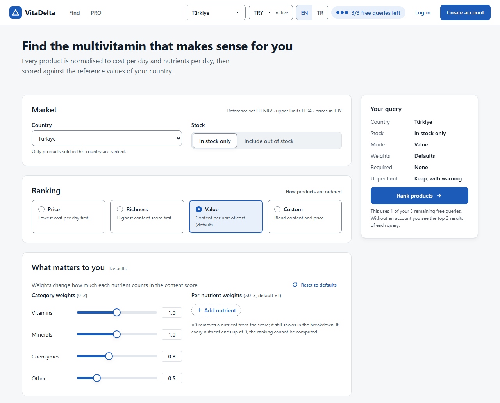
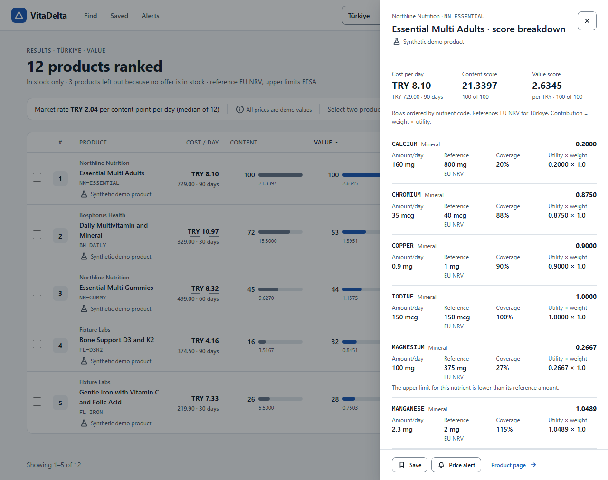
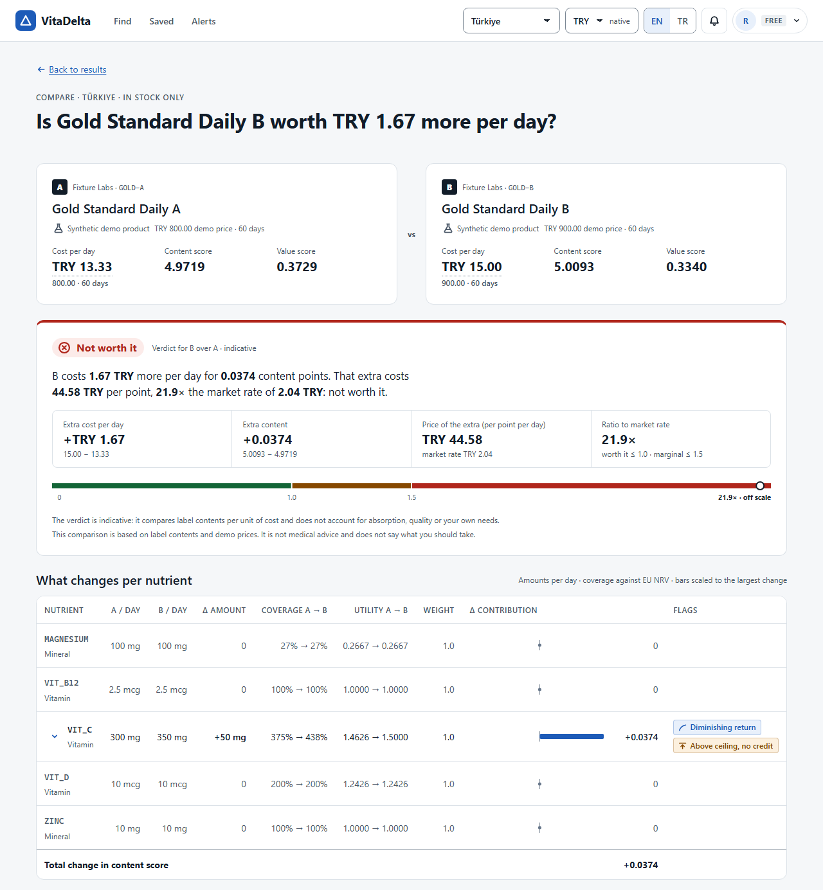

# VitaDelta

[English](README.md) · [Türkçe](README.tr.md)

VitaDelta compares multivitamin and mineral products within a country. For each product it shows how much of the country's reference intake values the label covers, where a nutrient reaches a tolerable upper limit, and what an effective daily dose costs. Products are ranked deterministically and every score can be broken down, so a reader can see why one product ranks above another and whether switching to a different product adds anything.

The system consists of an Angular web app served by nginx, a Spring Boot API that is the only owner of the PostgreSQL database, and a stateless Python scoring service that only the API can reach. The interface is available in Turkish and English.

Development has reached Phase 7: integration and hardening, with end-to-end suites, a security scan, encrypted backup and restore and an operations runbook on top of the complete product features. No payment provider is integrated, and there is no public deployment; the stack runs locally through Docker Compose. See the [architecture](docs/architecture.md), the [phase reports](docs/reports/) and the [runbook](docs/runbook.md).

## Screenshots

The following screens show synthetic demonstration data from the seeded fixtures; the brands and prices in them are fictional.


*Query builder: country, ranking mode, nutrient weights and filters.*


*Ranked results with the score breakdown of one product: coverage per nutrient, upper-limit handling and the price of an effective dose.*


*Comparison of two products: the marginal change per nutrient and the verdict on whether the switch is worth its price.*

## Implemented scope

| Phase | Area | Capabilities |
|---|---|---|
| 0 | Foundation | Monorepo, verified version pins, OpenAPI and JSON Schema contracts, Compose stack with nginx as the single public origin, CI workflow |
| 1 | Catalog data | Cited reference values and upper limits for four countries, synthetic fixtures, NIH DSLD label snapshot of 84 US products, catalog schema and idempotent seed |
| 2 | Scoring engine | Coverage with diminishing returns, upper-limit handling, value per effective dose, deterministic ranking, pairwise verdicts; golden and property tests, verdict calibration |
| 3 | Identity and plans | Registration with e-mail verification, rotating refresh sessions, password reset, FREE and PRO plans, promo codes, a single entitlement decision point |
| 4 | Core API | Catalog and product endpoints, ranked recommendations with the visitor trial quota and a ranking cache, pairwise comparison, admin imports of products and offers |
| 5 | Alerts and exchange rates | Saved products, price and stock alerts through a transactional outbox, notification inbox and e-mail, ECB rates for display currencies, admin health |
| 6 | Web application | Query builder, ranked results with breakdown and locked rows, comparison, product pages, account, alerts, inbox, admin pages; light and dark themes |
| 7 | Hardening | Security scan, header and routing assertions, encrypted backup and restore with a recorded drill, runbook, request-scoped logs and metrics, leakage tests, end-to-end job in CI |

Quotas, plan limits, result locking and role checks are decided by the API only; the web app renders the server's decisions. The scoring engine is pure: the same input gives the same ranking, with no randomness, no clock dependency and stable tie-breaks. Read the [architecture](docs/architecture.md) and the [scoring service notes](services/scoring/README.md) for the rules behind these behaviours.

## Technology

| Layer | Stack |
|---|---|
| Web | Angular 22.3, TypeScript 6.0, Transloco 8.4, Vitest 5.1; Node.js 22.23+ and npm |
| API | Java 25, Spring Boot 4.2.0, Gradle 9.9.2, Flyway, Resilience4j 2.4.0, Bucket4j 8.23.0, springdoc-openapi 3.2.1 |
| Scoring | Python 3.14, FastAPI 0.165.0, Pydantic 2.14.4, uvicorn 0.54.0, uv 0.13.9; Hypothesis for property tests |
| Data and edge | PostgreSQL 18.7, nginx 1.30.8, Docker Compose; Mailpit 1.34.0 in development |
| Contracts and tests | OpenAPI 3.1, openapi-generator 7.27.0, Testcontainers 2.0.5, Playwright 1.65.1, axe-core 4.14.0 |

## Local setup

Install Docker with Compose v2, JDK 25 (with `JAVA_HOME` pointing to it), Node.js 22.23 or newer in the 22 line, and [uv](https://docs.astral.sh/uv/) with Python 3.14. The scripts under `scripts/` are POSIX `bash`; on Windows run them from Git Bash or WSL. The JDK, Node.js and uv are needed for the test suites; the stack itself builds inside containers.

From the repository root:

```bash
scripts/dev-up.sh
scripts/seed.sh
```

On the first run `scripts/dev-up.sh` creates `.env` from `.env.example`, generates fresh random secrets into it, builds the images, starts the stack and waits until every service is healthy. An existing `.env` is never overwritten, and `.env` is ignored by Git. `scripts/seed.sh` loads the reference data, the synthetic fixtures and the label snapshot; it is idempotent. Then open http://localhost:8080.

Stop the stack with:

```bash
scripts/dev-down.sh             # keeps the database volume
scripts/dev-down.sh --volumes   # also deletes the database volume
```

| Service | Local address |
|---|---|
| Web app and API (nginx) | http://localhost:8080 (API under `/api/v1`) |
| Mailpit inbox | http://127.0.0.1:8025 |
| Mailpit API | http://127.0.0.1:8025/api/v1 |
| Mailpit SMTP | 127.0.0.1:1025 |
| PostgreSQL | 127.0.0.1:54320 |

nginx is the only service published on all interfaces. The API and the scoring service have no published ports, and the scoring service sits on an internal network that only the API joins. Mailpit and PostgreSQL listen on the loopback address only.

There are no default credentials. The first administrator is created by the API at start-up from `VITADELTA_BOOTSTRAP_ADMIN_EMAIL` and `VITADELTA_BOOTSTRAP_ADMIN_PASSWORD` in `.env`, and only when no administrator exists yet. To fill both values with a local address and a generated password:

```bash
scripts/dev-up.sh --bootstrap-admin
grep '^VITADELTA_BOOTSTRAP_ADMIN_' .env
```

The password exists only in your local `.env`. Changing the variables later does not change an existing administrator; use the password-reset flow instead.

### Trying it

- **Visitor.** Without an account, build a query and run it. A visitor has three free queries and sees the first three results of each ranking; the remaining rows are shown locked, and their data is never sent to the browser.
- **Account.** Register, open the verification e-mail in Mailpit and follow its link, then sign in. The same query now returns the full, paged ranking.
- **Compare.** Open the breakdown of a result, or pick two products and compare them to see the marginal change per nutrient and the verdict.
- **Alerts.** Save a product and create a price-drop alert. As the administrator, import `data/fixtures/offers.price-drop.synthetic.csv` on the admin imports page; within about ten seconds a notification appears in the inbox and the alert e-mail arrives in Mailpit.

The API can be tried directly through nginx. A visitor query, a comparison and the served OpenAPI document (keep the cookie file to stay the same visitor; the fourth query answers `quota_exceeded`):

```bash
API=http://localhost:8080/api/v1
JSON='Content-Type: application/json'
curl -s "$API/countries"
curl -s "$API/products?country=TR&q=gold"
curl -s -c cookies.txt -b cookies.txt -X POST "$API/recommendations/query" -H "$JSON" \
  -d '{"country": "TR"}'
A=$(curl -s "$API/products?country=TR&q=Gold%20Standard%20Daily%20A" | grep -o '"id":"[^"]*"' | head -1 | cut -d'"' -f4)
B=$(curl -s "$API/products?country=TR&q=Gold%20Standard%20Daily%20B" | grep -o '"id":"[^"]*"' | head -1 | cut -d'"' -f4)
curl -s -X POST "$API/recommendations/compare" -H "$JSON" \
  -d "{\"country\": \"TR\", \"baselineProductId\": \"$A\", \"candidateProductId\": \"$B\"}"
curl -s "$API/openapi.json"
```

Registering, verifying through Mailpit, saving a product and subscribing to a price-drop alert:

```bash
API=http://localhost:8080/api/v1
JSON='Content-Type: application/json'
curl -s -X POST "$API/auth/register" -H "$JSON" \
  -d '{"email": "me@example.com", "password": "correct-horse-battery", "countryCode": "TR"}'
VERIFY=
until [ -n "$VERIFY" ]; do
  sleep 1
  VERIFY=$(curl -s http://127.0.0.1:8025/api/v1/message/latest | grep -o '#token=[A-Za-z0-9_-]*' | head -1 | cut -d= -f2)
done
curl -s -X POST "$API/auth/verify-email" -H "$JSON" -d "{\"token\": \"$VERIFY\"}"
ACCESS=$(curl -s -X POST "$API/auth/login" -H "$JSON" \
  -d '{"email": "me@example.com", "password": "correct-horse-battery"}' | grep -o '"accessToken":"[^"]*"' | cut -d'"' -f4)
PRODUCT=$(curl -s "$API/products?country=TR&q=Gold%20Standard%20Daily%20B" | grep -o '"id":"[^"]*"' | head -1 | cut -d'"' -f4)
curl -s -X POST "$API/me/saved-products" -H "$JSON" -H "Authorization: Bearer $ACCESS" \
  -d "{\"productId\": \"$PRODUCT\", \"countryCode\": \"TR\"}"
curl -s -X POST "$API/me/alerts" -H "$JSON" -H "Authorization: Bearer $ACCESS" \
  -d "{\"productId\": \"$PRODUCT\", \"countryCode\": \"TR\", \"trigger\": \"PRICE_DROP\", \"thresholdPercent\": 5}"
curl -s "$API/me/notifications" -H "Authorization: Bearer $ACCESS"
curl -s -X POST "$API/recommendations/query" -H "$JSON" -H "Authorization: Bearer $ACCESS" \
  -d '{"country": "TR", "displayCurrency": "USD"}'
```

The price-drop import (`POST /api/v1/admin/imports/offers`, multipart field `file`, administrator only) lowers the price of Gold Standard Daily B from 900.00 to 846.00 TRY, which fires the alert above. Import formats are defined in [contracts/schemas](contracts/schemas/).

## Product and data boundaries

VitaDelta provides comparative information only. It is not medical advice and does not replace a conversation with a physician or pharmacist; every recommendation and comparison screen shows this notice.

The real US products are a committed snapshot of label data from the [NIH Dietary Supplement Label Database](https://dsld.od.nih.gov/) (DSLD), retrieved on 2026-11-24 through its public API, and are never fetched at run time. Brand and product names are used for identification only; VitaDelta is not affiliated with, or endorsed by, the brands or NIH. Each product shows its label entry date, and no label images or logos are used. Every price and retailer in the repository is synthetic demonstration data, including the offers of the real products, and the golden and test fixtures use fictional brands. Details are in [ADR-0012](docs/adr/0012-real-label-data-source.md) and [data/real](data/real/README.md).

Exchange rates are ECB reference rates fetched through Frankfurter and refreshed every six hours. They are indicative only; when no rate is stored for a currency pair, prices stay in their native currency and the response says so. No payment provider is integrated: PRO is granted by a promo code or by an administrator, and the upgrade page shows the price for information. The privacy notice is a complete draft in both languages that has not had a legal review. The deployment assumes exactly one API instance, because rate limits and caches are held in memory ([ADR-0011](docs/adr/0011-single-instance-and-job-locks.md)).

## Validation

```bash
scripts/test-all.sh                  # contracts, data tools, scoring, API, web and the security scan
RUN_E2E=1 scripts/test-all.sh        # adds the nginx routing check and both end-to-end suites (stack up and seeded)
scripts/security-scan.sh             # secrets, SQL concatenation, dependency audits, Dependabot configuration
```

The suites can also be run on their own:

```bash
# scoring (from services/scoring)
uv sync --locked
uv run --locked ruff check .
uv run --locked ruff format --check .
uv run --locked mypy .
uv run --locked pytest

# api (from services/api, with JAVA_HOME set to JDK 25; needs a Docker daemon for Testcontainers)
./gradlew check

# web (from apps/web)
npm ci
npm run lint
npm test
npm run build
npm run e2e
npm run e2e:adversarial
```

| Check | Latest measured result | Date |
|---|---|---|
| API (`./gradlew check`) | 1332 tests, 0 failures; line coverage 96.4 % (gate 85 %) | 2026-11-25 |
| API adversarial suite | 173 tests pass, part of the API run | 2026-11-25 |
| Web unit and component tests | 686 tests in 64 files; line coverage 95.35 % (gate 70 %) | 2026-11-25 |
| Web build | initial bundle 117.01 kB gzipped (budget 380 kB) | 2026-11-25 |
| Scoring (`pytest`) | 369 tests; line coverage 99.30 % (gate 95 %) | 2026-11-24 |
| End-to-end suites on a fresh stack | 26 regular and 51 adversarial tests pass | 2026-11-25 |
| Security scan | 7 checks pass; the OWASP dependency check is skipped without an NVD API key | 2026-11-25 |

The end-to-end figures come from the Phase 6 gate; the scoring figures from the Phase 2 report. CI runs the test suites and the security scan on every push; the end-to-end job runs for pull requests and the default branch and is informational.

## Documentation

- [Architecture](docs/architecture.md) · [Runbook](docs/runbook.md) · [Contracts](contracts/)
- Phase reports: [0](docs/reports/phase-0.md) · [1](docs/reports/phase-1.md) · [2](docs/reports/phase-2.md) · [3](docs/reports/phase-3.md) · [4](docs/reports/phase-4.md) · [5](docs/reports/phase-5.md) · [6](docs/reports/phase-6.md)
- Service notes: [scoring](services/scoring/README.md) · [verdict calibration](services/scoring/calibration/verdict-calibration.md) · [web app](apps/web/README.md) · [label snapshot](data/real/README.md)
- [Architecture decisions](docs/adr/):
  - [0001](docs/adr/0001-monorepo.md) Monorepo with three deployables and shared contracts
  - [0002](docs/adr/0002-scoring-in-python.md) Scoring in Python as a stateless service; the API is the only database owner
  - [0003](docs/adr/0003-sync-rest-with-resilience.md) Synchronous REST to scoring with timeout, retry and circuit breaker
  - [0004](docs/adr/0004-reference-resolution-hierarchy.md) Reference resolution, utility ceiling and upper-limit application
  - [0005](docs/adr/0005-version-pins.md) Version pins
  - [0006](docs/adr/0006-identity-and-sessions.md) Identity: Argon2id, access tokens with key id, rotating refresh tokens, signed visitor cookie
  - [0007](docs/adr/0007-entitlements.md) Entitlements: data-driven plans, server-side enforcement, visitor truncation
  - [0008](docs/adr/0008-transactional-outbox.md) Transactional outbox for offer changes and e-mail delivery
  - [0009](docs/adr/0009-fx-provider.md) Exchange-rate port with Frankfurter (ECB) and display-only conversion
  - [0010](docs/adr/0010-billing-port.md) Billing port with promo-code and manual adapters; payment provider deferred
  - [0011](docs/adr/0011-single-instance-and-job-locks.md) Single API instance with advisory locks for scheduled jobs
  - [0012](docs/adr/0012-real-label-data-source.md) Real US label data from NIH DSLD as a snapshot with synthetic prices
  - [0013](docs/adr/0013-migration-numbering.md) Migration numbers reserved per module
