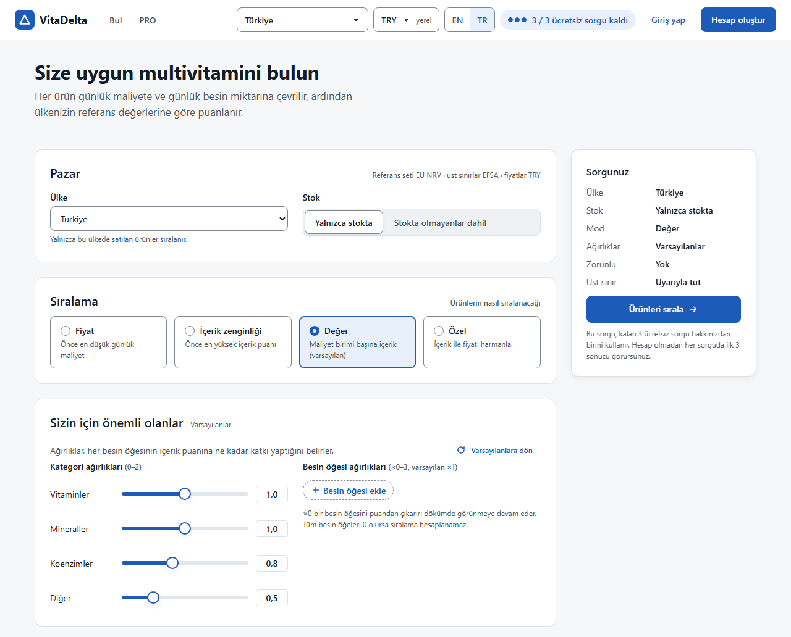
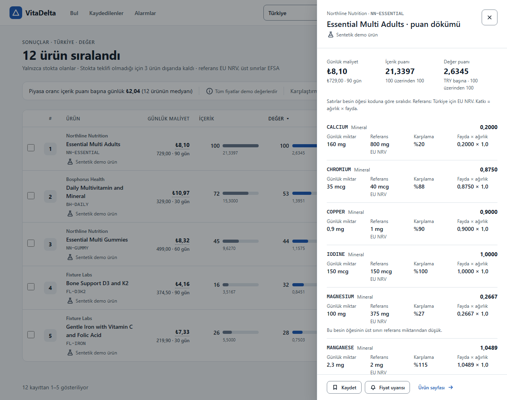
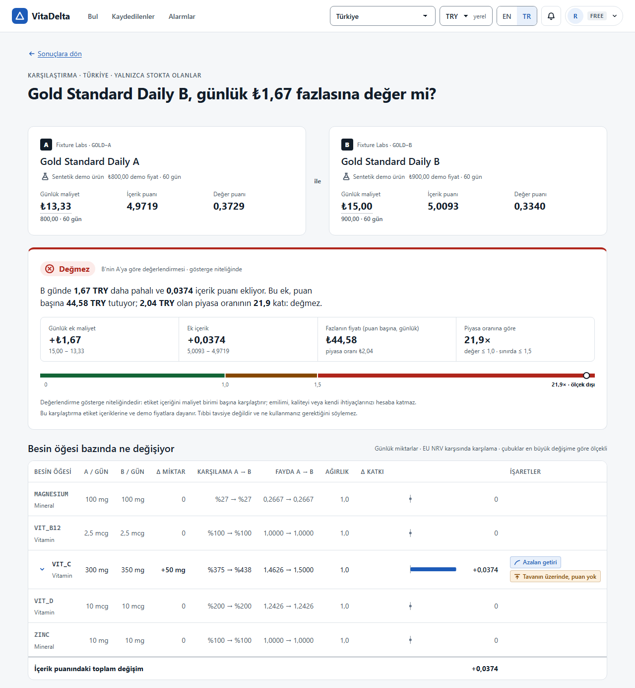

# VitaDelta

[English](README.md) · [Türkçe](README.tr.md)

VitaDelta, bir ülkedeki multivitamin ve mineral ürünlerini karşılaştırır. Her ürün için etiketin o ülkenin referans alım değerlerini ne ölçüde karşıladığını, hangi besin öğesinin tolere edilebilir üst sınıra ulaştığını ve etkili bir günlük dozun maliyetini gösterir. Ürünler deterministik olarak sıralanır ve her puan bileşenlerine ayrılabilir; böylece okuyucu bir ürünün neden diğerinin önünde olduğunu ve başka bir ürüne geçmenin bir şey katıp katmadığını görebilir.

Sistem; nginx üzerinden sunulan bir Angular web uygulaması, PostgreSQL veritabanının tek sahibi olan bir Spring Boot API ve yalnızca API'nin erişebildiği durumsuz bir Python puanlama servisinden oluşur. Arayüz Türkçe ve İngilizce dillerini destekler.

Geliştirme Faz 7'ye ulaşmıştır: tamamlanmış ürün özelliklerinin üzerine uçtan uca test paketleri, güvenlik taraması, şifreli yedekleme ve geri yükleme ile bir işletim kılavuzu getiren entegrasyon ve sağlamlaştırma fazı. Faz 8, PRO için test modunda isteğe bağlı bir Stripe ödeme sağlayıcısı ekler; yapılandırılmadıkça kapalıdır. Herkese açık bir kurulum yoktur; sistem Docker Compose ile yerel olarak çalışır. Ayrıntılar için [mimari](docs/architecture.md), [faz raporları](docs/reports/) ve [işletim kılavuzu](docs/runbook.md) belgelerine bakın.

## Ekran görüntüleri

Aşağıdaki ekranlarda tohumlanan fikstürlerden gelen sentetik demo verileri kullanılmıştır; içlerindeki markalar ve fiyatlar kurgusaldır.


*Sorgu oluşturucu: ülke, sıralama modu, besin öğesi ağırlıkları ve filtreler.*


*Bir ürünün puan dökümüyle sıralı sonuçlar: besin öğesi başına karşılama, üst sınır uygulaması ve etkili bir dozun fiyatı.*


*İki ürünün karşılaştırması: besin öğesi başına marjinal değişim ve geçişin fiyatına değip değmediğine dair karar.*

## Uygulanan kapsam

| Faz | Alan | Yetenekler |
|---|---|---|
| 0 | Temel | Monorepo, doğrulanmış sürüm sabitlemeleri, OpenAPI ve JSON Schema sözleşmeleri, tek genel giriş noktası nginx olan Compose yığını, CI iş akışı |
| 1 | Katalog verisi | Dört ülke için kaynak gösterilmiş referans değerleri ve üst sınırlar, sentetik fikstürler, 84 ABD ürününden oluşan NIH DSLD etiket anlık görüntüsü, katalog şeması ve idempotent tohumlama |
| 2 | Puanlama motoru | Azalan getirili karşılama, üst sınır uygulaması, etkili doz başına değer, deterministik sıralama, ikili kararlar; altın ve özellik tabanlı testler, karar kalibrasyonu |
| 3 | Kimlik ve planlar | E-posta doğrulamalı kayıt, dönen yenileme oturumları, parola sıfırlama, FREE ve PRO planları, promosyon kodları, tek bir yetki karar noktası |
| 4 | Çekirdek API | Katalog ve ürün uç noktaları, ziyaretçi deneme kotası ve sıralama önbelleğiyle sıralı öneriler, ikili karşılaştırma, ürün ve teklif için yönetici içe aktarımları |
| 5 | Uyarılar ve döviz kurları | Kaydedilen ürünler, işlemsel outbox üzerinden fiyat ve stok uyarıları, bildirim kutusu ve e-posta, gösterim para birimleri için ECB kurları, yönetici sağlık ekranı |
| 6 | Web uygulaması | Sorgu oluşturucu, döküm ve kilitli satırlarla sıralı sonuçlar, karşılaştırma, ürün sayfaları, hesap, uyarılar, gelen kutusu, yönetici sayfaları; açık ve koyu tema |
| 7 | Sağlamlaştırma | Güvenlik taraması, başlık ve yönlendirme doğrulamaları, kayıtlı tatbikatla şifreli yedekleme ve geri yükleme, işletim kılavuzu, istek kapsamlı loglar ve metrikler, sızıntı testleri, CI'da uçtan uca iş |
| 8 | Ödeme sağlayıcısı (isteğe bağlı) | Test modunda Stripe: barındırılan Checkout ve Billing Portal oturumları, PRO aboneliklerini başlatan, yenileyen ve sonlandıran imzası doğrulanmış ve idempotent webhook'lar; varsayılan olarak kapalı |

Kotalar, plan limitleri, sonuç kilitleme ve rol denetimleri yalnızca API tarafından kararlaştırılır; web uygulaması sunucunun kararlarını gösterir. Puanlama motoru saftır: aynı girdi aynı sıralamayı verir; rastgelelik, saat bağımlılığı yoktur ve eşitlikler kararlı biçimde bozulur. Bu davranışların ardındaki kurallar [mimari](docs/architecture.md) ve [puanlama servisi notları](services/scoring/README.md) belgelerinde açıklanır.

## Teknolojiler

| Katman | Teknoloji |
|---|---|
| Web | Angular 22.3, TypeScript 6.0, Transloco 8.4, Vitest 5.1; Node.js 22.23+ ve npm |
| API | Java 25, Spring Boot 4.2.0, Gradle 9.9.2, Flyway, Resilience4j 2.4.0, Bucket4j 8.23.0, springdoc-openapi 3.2.1 |
| Puanlama | Python 3.14, FastAPI 0.165.0, Pydantic 2.14.4, uvicorn 0.54.0, uv 0.13.9; özellik tabanlı testler için Hypothesis |
| Veri ve uç katman | PostgreSQL 18.7, nginx 1.30.8, Docker Compose; geliştirmede Mailpit 1.34.0 |
| Sözleşmeler ve testler | OpenAPI 3.1, openapi-generator 7.27.0, Testcontainers 2.0.5, Playwright 1.65.1, axe-core 4.14.0 |

## Yerel kurulum

Compose v2 ile Docker, JDK 25 (`JAVA_HOME` buna işaret edecek şekilde), 22 serisinde 22.23 veya daha yeni bir Node.js ve Python 3.14 ile [uv](https://docs.astral.sh/uv/) kurun. `scripts/` altındaki betikler POSIX `bash` betikleridir; Windows'ta Git Bash veya WSL içinden çalıştırın. JDK, Node.js ve uv test paketleri için gereklidir; yığının kendisi konteynerler içinde derlenir.

Depo kök dizininde:

```bash
scripts/dev-up.sh
scripts/seed.sh
```

`scripts/dev-up.sh` ilk çalıştırmada `.env.example` dosyasından `.env` oluşturur, içine yeni rastgele gizli anahtarlar üretir, imajları derler, yığını başlatır ve her servis sağlıklı olana kadar bekler. Var olan bir `.env` asla üzerine yazılmaz ve `.env` Git tarafından yok sayılır. `scripts/seed.sh` referans verilerini, sentetik fikstürleri ve etiket anlık görüntüsünü yükler; idempotenttir. Ardından http://localhost:8080 adresini açın.

Yığını durdurmak için:

```bash
scripts/dev-down.sh             # keeps the database volume
scripts/dev-down.sh --volumes   # also deletes the database volume
```

| Servis | Yerel adres |
|---|---|
| Web uygulaması ve API (nginx) | http://localhost:8080 (API `/api/v1` altında) |
| Mailpit gelen kutusu | http://127.0.0.1:8025 |
| Mailpit API | http://127.0.0.1:8025/api/v1 |

Tüm arayüzlerde yayımlanan tek servis nginx'tir. API, puanlama servisi ve PostgreSQL'in yayımlanan portu yoktur; puanlama servisi yalnızca API'nin katıldığı iç bir ağda bulunur. Mailpit yalnızca gelen kutusunu ve HTTP API'sini loopback adresinde yayımlar; SMTP portuna yalnızca compose ağından erişilir. SQL veritabanı konteyneri üzerinden çalıştırılır: `docker compose --env-file .env -f infra/docker-compose.yml exec -T postgres psql -U vitadelta -d vitadelta`.

Varsayılan giriş bilgisi yoktur. İlk yönetici, API açılışında `.env` içindeki `VITADELTA_BOOTSTRAP_ADMIN_EMAIL` ve `VITADELTA_BOOTSTRAP_ADMIN_PASSWORD` değerlerinden ve yalnızca henüz bir yönetici yoksa oluşturulur. İki değeri yerel bir adres ve üretilmiş bir parolayla doldurmak için:

```bash
scripts/dev-up.sh --bootstrap-admin
grep '^VITADELTA_BOOTSTRAP_ADMIN_' .env
```

Parola yalnızca yerel `.env` dosyanızda bulunur. Değişkenleri sonradan değiştirmek mevcut yöneticiyi değiştirmez; bunun yerine parola sıfırlama akışını kullanın.

### Denemek için

- **Ziyaretçi.** Hesap olmadan bir sorgu oluşturup çalıştırın. Ziyaretçinin üç ücretsiz sorgu hakkı vardır ve her sıralamanın ilk üç sonucunu görür; kalan satırlar kilitli gösterilir ve verileri tarayıcıya hiç gönderilmez.
- **Hesap.** Kayıt olun, doğrulama e-postasını Mailpit'te açıp bağlantısını izleyin, ardından giriş yapın. Aynı sorgu artık sayfalı, eksiksiz sıralamayı döndürür.
- **Karşılaştırma.** Bir sonucun dökümünü açın ya da iki ürün seçip karşılaştırarak besin öğesi başına marjinal değişimi ve kararı görün.
- **Uyarılar.** Bir ürünü kaydedin ve fiyat düşüşü uyarısı oluşturun. Yönetici olarak, yönetici içe aktarım sayfasında `data/fixtures/offers.price-drop.synthetic.csv` dosyasını içe aktarın; yaklaşık on saniye içinde gelen kutusunda bir bildirim belirir ve uyarı e-postası Mailpit'e düşer.

API doğrudan nginx üzerinden denenebilir. Bir ziyaretçi sorgusu, bir karşılaştırma ve sunulan OpenAPI belgesi (aynı ziyaretçi olarak kalmak için çerez dosyasını koruyun; dördüncü sorgu `quota_exceeded` ile yanıtlanır):

```bash
API=http://localhost:8080/api/v1
JSON='Content-Type: application/json'
curl -s "$API/countries"
curl -s "$API/products?country=TR&q=gold"
curl -s -c cookies.txt -b cookies.txt -X POST "$API/recommendations/query" -H "$JSON" \
  -d '{"country": "TR"}'
A=$(curl -s "$API/products?country=TR&q=Gold%20Standard%20Daily%20A" | grep -o '"id":"[^"]*"' | head -1 | cut -d'"' -f4)
B=$(curl -s "$API/products?country=TR&q=Gold%20Standard%20Daily%20B" | grep -o '"id":"[^"]*"' | head -1 | cut -d'"' -f4)
curl -s -X POST "$API/recommendations/compare" -H "$JSON" \
  -d "{\"country\": \"TR\", \"baselineProductId\": \"$A\", \"candidateProductId\": \"$B\"}"
curl -s "$API/openapi.json"
```

Kayıt olma, Mailpit üzerinden doğrulama, ürün kaydetme ve fiyat düşüşü uyarısına abone olma:

```bash
API=http://localhost:8080/api/v1
JSON='Content-Type: application/json'
curl -s -X POST "$API/auth/register" -H "$JSON" \
  -d '{"email": "me@example.com", "password": "correct-horse-battery", "countryCode": "TR"}'
VERIFY=
until [ -n "$VERIFY" ]; do
  sleep 1
  VERIFY=$(curl -s http://127.0.0.1:8025/api/v1/message/latest | grep -o '#token=[A-Za-z0-9_-]*' | head -1 | cut -d= -f2)
done
curl -s -X POST "$API/auth/verify-email" -H "$JSON" -d "{\"token\": \"$VERIFY\"}"
ACCESS=$(curl -s -X POST "$API/auth/login" -H "$JSON" \
  -d '{"email": "me@example.com", "password": "correct-horse-battery"}' | grep -o '"accessToken":"[^"]*"' | cut -d'"' -f4)
PRODUCT=$(curl -s "$API/products?country=TR&q=Gold%20Standard%20Daily%20B" | grep -o '"id":"[^"]*"' | head -1 | cut -d'"' -f4)
curl -s -X POST "$API/me/saved-products" -H "$JSON" -H "Authorization: Bearer $ACCESS" \
  -d "{\"productId\": \"$PRODUCT\", \"countryCode\": \"TR\"}"
curl -s -X POST "$API/me/alerts" -H "$JSON" -H "Authorization: Bearer $ACCESS" \
  -d "{\"productId\": \"$PRODUCT\", \"countryCode\": \"TR\", \"trigger\": \"PRICE_DROP\", \"thresholdPercent\": 5}"
curl -s "$API/me/notifications" -H "Authorization: Bearer $ACCESS"
curl -s -X POST "$API/recommendations/query" -H "$JSON" -H "Authorization: Bearer $ACCESS" \
  -d '{"country": "TR", "displayCurrency": "USD"}'
```

Fiyat düşüşü içe aktarımı (`POST /api/v1/admin/imports/offers`, multipart alanı `file`, yalnızca yönetici) Gold Standard Daily B'nin fiyatını 900.00 TRY'den 846.00 TRY'ye indirir ve yukarıdaki uyarıyı tetikler. İçe aktarım biçimleri [contracts/schemas](contracts/schemas/) altında tanımlıdır.

### İsteğe bağlı çevrim içi ödeme (Stripe test modu)

Çevrim içi ödeme varsayılan olarak kapalıdır (`VITADELTA_BILLING_PROVIDER` boş veya `none`): planlar `checkoutAvailable: false` bildirir ve faturalama uç noktaları `503 billing_unavailable` yanıtı verir. Denemek için Stripe panelinde test modunda aylık fiyatı olan bir ürün oluşturun, `.env` içinde `VITADELTA_BILLING_PROVIDER=stripe`, `VITADELTA_STRIPE_SECRET_KEY` (`sk_test_` anahtarı), `VITADELTA_STRIPE_PRICE_ID` ve `VITADELTA_STRIPE_WEBHOOK_SECRET` değerlerini ayarlayın, webhook'ları `stripe listen` ile yerel yığına yönlendirin ve API'yi yeniden oluşturun. Eksik bir yapılandırmayla veya canlı bir anahtarla API başlamayı reddeder. Adımlar, gizli anahtar rotasyonu ve sorun giderme [işletim kılavuzu bölüm 7.1](docs/runbook.md#71-online-payment-with-stripe-test-mode) içinde, tasarım ise [ADR-0014](docs/adr/0014-stripe-billing-provider.md) içindedir.

### TLS sonlandıran bir vekilin arkasında çalıştırma

Bu yığındaki nginx ilk duraktır ve her bağlantının eş adresini istemci adresi olarak kaydeder; API yalnızca bu girdiye güvenir (`X-Forwarded-For` üzerine yazılır, hiçbir zaman eklenmez), böylece istemci başına hız sınırları istemci başına çalışır. TLS'i nginx'in önünde sonlandıran başka bir vekil (örneğin yük dengeleyici) varsa `.env` içinde `VITADELTA_REAL_IP_FROM` değerini onun adresine veya CIDR bloğuna (virgül ya da boşlukla ayrılmış liste) ve birlikte `VITADELTA_TLS=true` olarak ayarlayın. nginx bu durumda istemci adresini yalnızca bu eşlerden gelen bağlantıların `X-Forwarded-For` başlığından geri kazanır (listedeki vekillerden biri olmayan en sağdaki adres) ve API'ye iletir. Bu ayar olmadan vekilin arkasındaki tüm istemciler tek bir hız sınırı kovasını paylaşır. İstemciler nginx'e doğrudan bağlanıyorsa boş bırakın; kontrol etmediğiniz ağları asla listelemeyin, çünkü onların ilettiği başlıklara inanılır. `infra/nginx/check-routing.sh` bu davranışı bir API taklidine karşı doğrular.

## Ürün ve veri sınırları

VitaDelta yalnızca karşılaştırmalı bilgi sunar. Tıbbi tavsiye değildir ve bir hekim ya da eczacıyla görüşmenin yerini tutmaz; her öneri ve karşılaştırma ekranı bu notu gösterir.

Gerçek ABD ürünleri, [NIH Dietary Supplement Label Database](https://dsld.od.nih.gov/) (DSLD) kaynağından 2026-11-24 tarihinde herkese açık API'si üzerinden alınmış ve depoya işlenmiş bir etiket verisi anlık görüntüsüdür; çalışma zamanında hiçbir zaman çekilmez. Marka ve ürün adları yalnızca tanımlama amacıyla kullanılır; VitaDelta'nın markalarla veya NIH ile bir bağı yoktur ve onlar tarafından desteklenmez. Her ürün etiketinin giriş tarihini gösterir; etiket görseli veya logo kullanılmaz. Depodaki tüm fiyatlar ve satıcılar, gerçek ürünlerin teklifleri dahil, sentetik demo verileridir; altın ve test fikstürleri kurgusal markalar kullanır. Ayrıntılar [ADR-0012](docs/adr/0012-real-label-data-source.md) ve [data/real](data/real/README.md) belgelerindedir.

Döviz kurları Frankfurter üzerinden alınan ve altı saatte bir yenilenen ECB referans kurlarıdır. Yalnızca gösterge niteliğindedir; bir para birimi çifti için kayıtlı kur yoksa fiyatlar kendi para biriminde kalır ve yanıt bunu belirtir. PRO bir promosyon koduyla, bir yönetici tarafından veya isteğe bağlı Stripe sağlayıcısı etkinse Stripe'ın barındırılan ödeme sayfasında satın alınan bir abonelikle verilir; kart verileri VitaDelta'ya hiç ulaşmaz ve canlı anahtarlara açıkça izin verilmedikçe yalnızca test modu anahtarları kabul edilir. Gizlilik bildirimi iki dilde de tamamlanmış bir taslaktır ve hukuki incelemeden geçmemiştir. Hız limitleri ve önbellekler bellekte tutulduğundan kurulum tam olarak tek bir API örneği varsayar ([ADR-0011](docs/adr/0011-single-instance-and-job-locks.md)).

## Doğrulama

```bash
scripts/test-all.sh                  # contracts, data tools, scoring, API, web and the security scan
RUN_E2E=1 scripts/test-all.sh        # adds the nginx routing check and both end-to-end suites (stack up and seeded)
scripts/security-scan.sh             # secrets, SQL concatenation, dependency audits, Dependabot configuration
```

Test paketleri tek tek de çalıştırılabilir:

```bash
# scoring (from services/scoring)
uv sync --locked
uv run --locked ruff check .
uv run --locked ruff format --check .
uv run --locked mypy .
uv run --locked pytest

# api (from services/api, with JAVA_HOME set to JDK 25; needs a Docker daemon for Testcontainers)
./gradlew check

# web (from apps/web)
npm ci
npm run lint
npm test
npm run build
npm run e2e
npm run e2e:adversarial
```

| Denetim | Son ölçülen sonuç | Tarih |
|---|---|---|
| API (`./gradlew check`) | 1399 test, 0 hata; satır kapsamı %96,4 (eşik %85) | 2026-11-25 |
| API saldırgan test paketi | 194 test geçer, API çalıştırmasının parçası | 2026-11-25 |
| Web birim ve bileşen testleri | 64 dosyada 693 test; satır kapsamı %95,4 (eşik %70) | 2026-11-25 |
| Web derlemesi | ilk paket gzip ile 117 kB (bütçe 380 kB) | 2026-11-25 |
| Puanlama (`pytest`) | 369 test; satır kapsamı %99,30 (eşik %95) | 2026-11-24 |
| Temiz yığında uçtan uca paketler | [Faz 7 raporuna](docs/reports/phase-7.md) bakın | 2026-11-25 |
| Güvenlik taraması | diğer 8 denetimin tümü geçer; bağımlılık güvenlik açığı denetimi (OWASP Dependency-Check) NVD API anahtarı olmadan atlanır | 2026-11-25 |

Son çalıştırmanın uçtan uca rakamları Faz 7 raporundadır; puanlama rakamları Faz 2 raporundan alınmıştır. CI her push'ta test paketlerini ve güvenlik taramasını çalıştırır; uçtan uca iş pull request'ler ve varsayılan dal için çalışır ve bilgilendirme amaçlıdır.

## Lisans

Kaynak kod GNU Affero Genel Kamu Lisansı v3.0 ile lisanslanmıştır ([LICENSE](LICENSE)). `data/real/` altındaki referans veriler NIH Dietary Supplement Label Database kaynaklıdır ve ADR-0012'de anlatılan kendi koşullarını korur; demo fiyatlar ve test verileri sentetiktir.

## Belgeler

- [Mimari](docs/architecture.md) · [İşletim kılavuzu](docs/runbook.md) · [Sözleşmeler](contracts/)
- Faz raporları: [0](docs/reports/phase-0.md) · [1](docs/reports/phase-1.md) · [2](docs/reports/phase-2.md) · [3](docs/reports/phase-3.md) · [4](docs/reports/phase-4.md) · [5](docs/reports/phase-5.md) · [6](docs/reports/phase-6.md) · [7](docs/reports/phase-7.md) · [8](docs/reports/phase-8.md)
- Servis notları: [puanlama](services/scoring/README.md) · [karar kalibrasyonu](services/scoring/calibration/verdict-calibration.md) · [web uygulaması](apps/web/README.md) · [etiket anlık görüntüsü](data/real/README.md)
- [Mimari kararlar](docs/adr/):
  - [0001](docs/adr/0001-monorepo.md) Üç dağıtılabilir birim ve ortak sözleşmelerle monorepo
  - [0002](docs/adr/0002-scoring-in-python.md) Durumsuz bir servis olarak Python'da puanlama; veritabanının tek sahibi API
  - [0003](docs/adr/0003-sync-rest-with-resilience.md) Zaman aşımı, yeniden deneme ve devre kesiciyle puanlamaya eşzamanlı REST
  - [0004](docs/adr/0004-reference-resolution-hierarchy.md) Referans çözümleme, fayda tavanı ve üst sınır uygulaması
  - [0005](docs/adr/0005-version-pins.md) Sürüm sabitlemeleri
  - [0006](docs/adr/0006-identity-and-sessions.md) Kimlik: Argon2id, anahtar kimlikli erişim belirteçleri, dönen yenileme belirteçleri, imzalı ziyaretçi çerezi
  - [0007](docs/adr/0007-entitlements.md) Yetkiler: veriye dayalı planlar, sunucu tarafında uygulama, ziyaretçi için kırpma
  - [0008](docs/adr/0008-transactional-outbox.md) Teklif değişiklikleri ve e-posta teslimi için işlemsel outbox
  - [0009](docs/adr/0009-fx-provider.md) Frankfurter (ECB) ile döviz kuru portu ve yalnızca gösterim amaçlı dönüştürme
  - [0010](docs/adr/0010-billing-port.md) Promosyon kodu ve manuel bağdaştırıcılarla faturalama portu; ödeme sağlayıcısı ertelendi
  - [0011](docs/adr/0011-single-instance-and-job-locks.md) Zamanlanmış işler için advisory lock ile tek API örneği
  - [0012](docs/adr/0012-real-label-data-source.md) Sentetik fiyatlarla anlık görüntü olarak NIH DSLD kaynaklı gerçek ABD etiket verisi
  - [0013](docs/adr/0013-migration-numbering.md) Modül başına ayrılmış migration numaraları
  - [0014](docs/adr/0014-stripe-billing-provider.md) Barındırılan sayfalar ve doğrulanmış webhook'larla isteğe bağlı ödeme sağlayıcısı olarak Stripe
