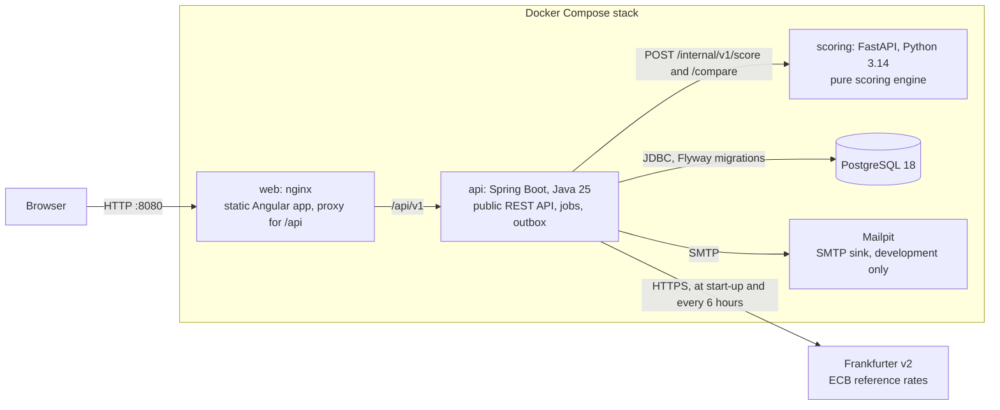
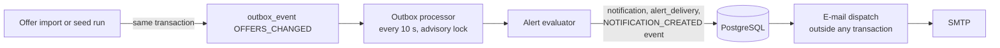

# VitaDelta architecture

This document summarises how the parts of VitaDelta fit together. The decisions behind it are recorded in the [ADRs](adr/); the interfaces are defined in [`contracts/`](../contracts/), which are authoritative for the web app, the API and the scoring service.

## Context and containers

- **web** (nginx) is the single public origin. It serves the built Angular app, proxies `/api` to the API, sets the security headers and is the only container published on all interfaces.
- **api** (Spring Boot) is the only owner of the database. It serves the public REST API under `/api/v1`, builds the scoring input, enforces every quota, plan limit and role, converts money for display, runs the scheduled jobs and sends e-mail. Its port is not published.
- **scoring** (FastAPI) is stateless and pure: every request carries the candidates, the market profile, the reference values, the upper limits and the weights. It has no database access, makes no outbound calls and does no currency conversion. It sits on an internal network that only the API joins ([ADR-0002](adr/0002-scoring-in-python.md)).
- **PostgreSQL** holds the catalog, accounts, subscriptions, notifications, the outbox and exchange rates. Schema changes are Flyway migrations with numbers reserved per module ([ADR-0013](adr/0013-migration-numbering.md)).
- **Mailpit** catches outgoing e-mail in the local stack; any SMTP server can take its place through the `VITADELTA_SMTP_*` settings.
- **Frankfurter v2** is the only external dependency at run time. The API requests ECB rates explicitly (`providers=ECB`) so that the stored rates are reproducible reference rates ([ADR-0009](adr/0009-fx-provider.md)).

PostgreSQL publishes no port; SQL runs through the database container. Mailpit publishes only its inbox and HTTP API on the loopback address, and its SMTP port is reachable from the compose network only.

## Recommendation query

`POST /api/v1/recommendations/query` runs through these steps:

1. **Principal.** A valid access token identifies a user. Without one, the caller is a visitor identified by the signed `vd_anon` cookie (created when missing) and is subject to a per-IP rate limit for visitor queries.
2. **Quota reservation.** For a visitor, one query is reserved by an atomic conditional `UPDATE` on the visitor row in its own short transaction. When no row is updated the answer is `403 quota_exceeded` with the limit and `action: "SIGN_UP"`. Users have no query quota.
3. **Ranking cache.** The full native-currency ranking is cached under a key made of the normalised query and the catalog version (500 entries, 10 minutes). Any catalog change bumps the version, so a stale ranking is never served for a new catalog.
4. **Scoring call.** On a cache miss the API reads the country's catalog, reference values, upper limits and effective prices in a separate read-only transaction that is closed before the call, so no database connection is held while scoring runs. The generated client uses a 500 ms connect and 2 s read timeout, one retry on connection errors only, and a circuit breaker; when scoring is unavailable the answer is `503 scoring_unavailable`, while cache hits are still served ([ADR-0003](adr/0003-sync-rest-with-resilience.md)).
5. **Refund.** Any outcome after the reservation other than an answer gives the visitor's query back, exactly once.
6. **Presentation.** A visitor receives the top three items of the full ranking whatever page is requested; locked items are not sent in any form, and `meta.visibility` reports `shown`, `total` and `locked`. Users receive full paged results. Money is converted to the display currency with one rounding, and the response states the rate, its date and its status. Saved and alert states are added for users after paging, never inside the cached ranking.

`POST /api/v1/recommendations/compare` uses the same scoring client for a pairwise analysis and has no quota; it is limited by per-IP rate limits only.

## Product detail

`GET /api/v1/products/{id}` answers from the catalog alone and never calls the scoring service. Each nutrient row carries the facts of the requested country: `reference` (the value of the country's reference set and the percentage of it covered per day) and `upperLimit` (the row of the country's upper-limit set that applies to the row's form, with `exceeded`). Both are `null` when the set defines no applicable value, the matched limit is exempt or depends on a form the label does not state; they are comparative information, not medical advice. Products that are not sold or are discontinued in the country expose none of these facts.

## Entitlements

| Principal | Ranking | Saved products | Active alerts | Notifications |
|---|---|---|---|---|
| Visitor | 3 queries, top 3 results visible | none | none | none |
| FREE | full, paged | 5 | 3 | 30 per calendar month (UTC) |
| PRO | full, paged | unlimited | unlimited | unlimited |

Plans are rows in the `plan` table, read through a cached plan service, and never taken from token claims. A single `EntitlementService` decides every limited action. Saving a product and creating or activating an alert lock the user's row, count and write in one transaction, so parallel requests cannot exceed a limit; a refusal is `403 entitlement_exceeded` with the limit, the usage and the upgrade target. The web app only renders these decisions. PRO is activated through the billing port by a promo code, by an administrator, or, when the optional Stripe provider is configured, by a subscription bought on Stripe's hosted checkout. Stripe changes a subscription only through signature-verified webhooks: the API reads the referenced subscription from Stripe, applies it under the user's row lock, records each event id once and only ever moves a paid period forward ([ADR-0007](adr/0007-entitlements.md), [ADR-0010](adr/0010-billing-port.md), [ADR-0014](adr/0014-stripe-billing-provider.md)). When PRO expires, nothing is deleted: excess saved products stay, and alerts beyond the FREE limit are deactivated from the newest.

## Alert pipeline

1. An offers import (or a seed run) computes the effective-price state of every product and country whose offers changed and writes one `OFFERS_CHANGED` event in the same transaction as the data change, carrying the committed catalog version.
2. The outbox processor claims up to 100 due events with `FOR UPDATE SKIP LOCKED` and a two-minute lease. Events of one product and country are processed strictly in order.
3. The alert evaluator matches the event against subscriptions (price drop against a per-subscription baseline, back in stock, price change), ignores changes older than the subscription, applies the monthly notification cap and writes the notification, an `alert_delivery` row (unique per subscription and event) and a `NOTIFICATION_CREATED` event in one short transaction.
4. E-mail dispatch for `NOTIFICATION_CREATED` re-reads the notification and calls SMTP outside any transaction or row lock. Unverified, disabled or opted-out recipients are skipped.
5. A failed event is retried after 2, 4, 8 and 16 minutes; the fifth failure marks it as a dead letter, which `GET /admin/outbox/stats` counts. Delivery is at least once; a duplicate e-mail is possible only if the process stops between SMTP acceptance and the commit ([ADR-0008](adr/0008-transactional-outbox.md)).

Every scheduled job (outbox, exchange-rate refresh, subscription expiry, housekeeping) and the administrator bootstrap runs under its own PostgreSQL advisory lock and skips its turn when the lock is taken ([ADR-0011](adr/0011-single-instance-and-job-locks.md)).

## Data model

| Module | Migration | Tables |
|---|---|---|
| Catalog | `V1__catalog.sql` | `nutrient`, `reference_set`, `reference_value`, `ul_set`, `upper_limit`, `unit_conversion`, `country`, `product`, `product_nutrient`, `product_availability`, `offer`, `catalog_version`, `import_job`, `import_job_error` |
| Identity and plans | `V2__identity_and_plans.sql` | `app_user`, `refresh_token`, `email_token`, `plan`, `subscription`, `promo_code`, `promo_redemption`, `anonymous_identity`, `saved_product`, `alert_subscription`, `usage_counter` |
| Notifications and outbox | `V3__notifications_and_outbox.sql` | `notification`, `outbox_event`, `alert_delivery` |
| Exchange rates | `V4__fx_rates.sql` | `fx_rate` |
| Catalog (forms) | `V5__form_registry_and_ul_notes.sql` | `nutrient_form`; form membership enforced on product nutrients, citation notes on upper limits |
| Alerts | `V6__alert_ordering.sql` | ordering columns on `outbox_event`, catalog-version boundary on `alert_subscription` |
| Billing provider | `V7__billing_provider.sql` | `billing_customer`, `billing_subscription`, `billing_webhook_event` |

Every committing catalog write bumps `catalog_version` exactly once, which keys the ranking cache and the alert boundaries. Real label products carry `source = 'DSLD'`, the label id and its entry date; their offers and all other prices are synthetic ([ADR-0012](adr/0012-real-label-data-source.md)).

## Security posture

- **Passwords and tokens.** Argon2id with explicit parameters; a dummy hash keeps unknown-account logins at the same cost. Access tokens are HS256 JWTs with a `kid`, valid for 15 minutes and kept in memory by the web app only. Refresh tokens are random values in the `vd_refresh` cookie (`HttpOnly`, `SameSite=Strict`, scoped to `/api/v1/auth`, `Secure` outside development), stored as hashes, rotated on every use, with a 20-second grace window and family revocation on reuse. Signing secrets rotate through `VITADELTA_JWT_SECRET_PREVIOUS` ([ADR-0006](adr/0006-identity-and-sessions.md)).
- **Request forgery.** Refresh and logout require `X-Requested-With: vitadelta`; cookie-bearing auth endpoints also require a JSON content type and an allowed `Origin` when one is sent.
- **Headers.** nginx sets a Content Security Policy with scripts limited to `'self'`, `X-Content-Type-Options: nosniff`, `X-Frame-Options: DENY`, a restrictive `Permissions-Policy` and a `Referrer-Policy` per location, and adds HSTS only when `VITADELTA_TLS=true`. `infra/nginx/check-routing.sh` asserts the exact values on every response class.
- **Rate limits and back-off.** In-memory per-IP and per-account limits cover visitor queries, visitor identity creation, login, auth e-mails and promo redemption; failed logins lock an address with doubling lock times. Limits are per instance, which is correct under the single-instance assumption.
- **Leakage.** Errors are RFC 9457 problem documents without class names, SQL or stack frames; logs are structured JSON with a request id, and credentials, tokens, promo codes and full e-mail addresses are redacted. Both are covered by tests.
- **Adversarial suites.** Separate API and browser suites attack ownership, limits under concurrency, token handling, open redirects, stored script payloads, locked-data exposure, the outbox and the exchange-rate provider boundary. They run at every phase gate.
- **Scanning and recovery.** `scripts/security-scan.sh` checks the Git history and tree for secrets, guards against SQL string concatenation and audits npm and Python dependencies. `scripts/backup.sh` writes `age`-encrypted dumps; `scripts/restore.sh` restores into an isolated stack. Procedures are in the [runbook](runbook.md).

## Operations

The operations layer is a set of scripts and CI jobs around the stack. `scripts/backup.sh` writes `age`-encrypted dumps with a 14-day retention, and `scripts/restore.sh` restores a dump into a separate compose project (`infra/docker-compose.restore.yml`) that never touches the live stack. `scripts/security-scan.sh` runs the secret scan, the tracked-file and SQL-concatenation guards, npm audit, pip-audit, the Dependency-Check plugin (only with an NVD API key), the Dependabot coverage check and the action-pinning check. On GitHub Actions the `test` job runs `scripts/test-all.sh`, the `security` job runs the security scan with gitleaks over the full history, and the informational `e2e` job runs the end-to-end and adversarial browser suites against the compose stack for pull requests and the default branch. The API exposes health and Micrometer metrics on a management port that is neither published nor proxied; the metric and log-field catalogue is in the [runbook](runbook.md).

## Decision records

| ADR | Topic |
|---|---|
| [0001](adr/0001-monorepo.md) | Monorepo with three deployables and shared contracts |
| [0002](adr/0002-scoring-in-python.md) | Stateless Python scoring service; the API owns the database |
| [0003](adr/0003-sync-rest-with-resilience.md) | Synchronous REST with timeouts, retry and circuit breaker |
| [0004](adr/0004-reference-resolution-hierarchy.md) | Reference resolution, utility ceiling and upper limits |
| [0005](adr/0005-version-pins.md) | Version pins |
| [0006](adr/0006-identity-and-sessions.md) | Passwords, tokens, sessions and the visitor cookie |
| [0007](adr/0007-entitlements.md) | Plans, server-side enforcement and visitor truncation |
| [0008](adr/0008-transactional-outbox.md) | Transactional outbox and e-mail delivery |
| [0009](adr/0009-fx-provider.md) | Exchange-rate provider and display-only conversion |
| [0010](adr/0010-billing-port.md) | Billing port; payment provider deferred |
| [0011](adr/0011-single-instance-and-job-locks.md) | Single instance and job locks |
| [0012](adr/0012-real-label-data-source.md) | Real label data snapshot with synthetic prices |
| [0013](adr/0013-migration-numbering.md) | Migration numbering per module |
| [0014](adr/0014-stripe-billing-provider.md) | Stripe as the optional payment provider |
